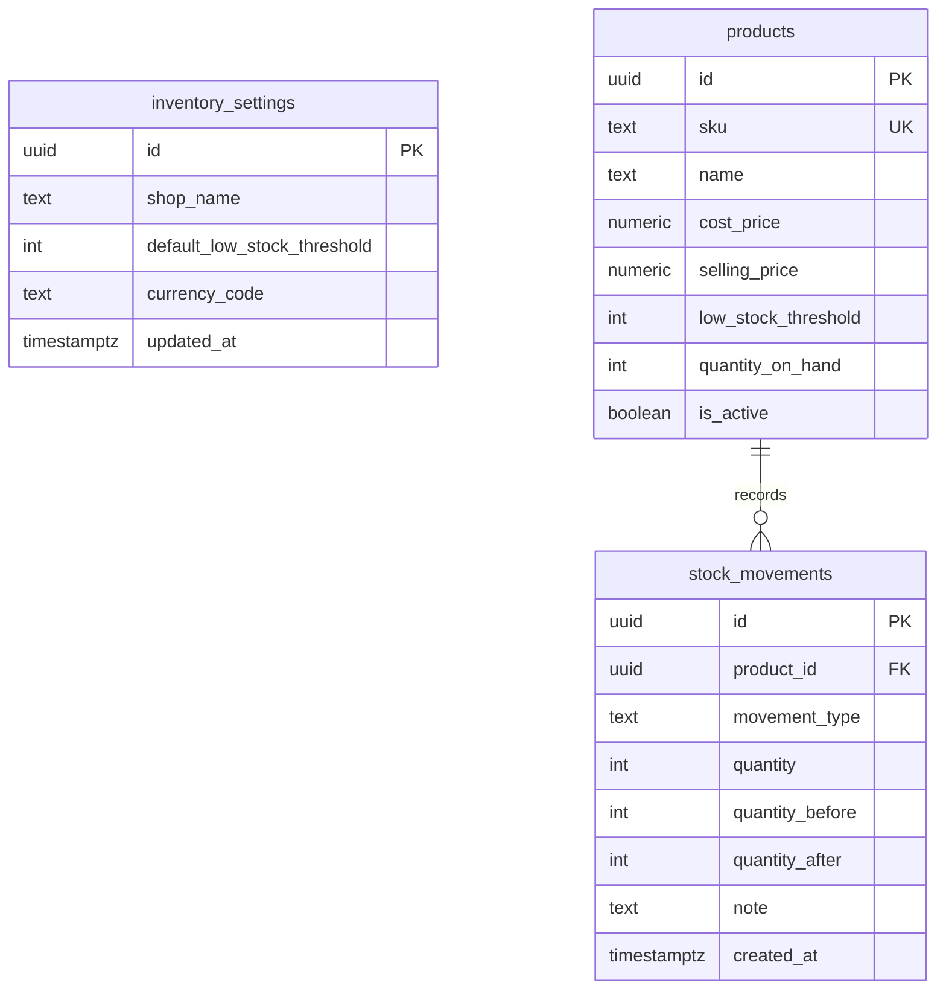

# StockFlow

A small inventory app for one shop. Version 1 tracks products, stock coming in and going out, low stock, and movement history.

The interface follows the dark-sidebar design in [StockFlow — Mini Inventory](https://www.figma.com/design/C50FEkceKurmTxrnzBFM9Q).

## What works now

Phase 1 is the foundation:

- Next.js app with the sidebar layout for Dashboard, Products, Stock Movements, Settings, and Configuration
- Configuration, where the admin creates an account and sets read, write, edit, and delete for each section
- A clear message when the Supabase environment variables are missing
- Database schema, stock movement function, and development seed
- Products page that reads products from Supabase, with search, stock-level filter, and a form to add a product
- Dashboard totals, low-stock list, and recent movements calculated from the database
- Movement history, with a link from each dashboard row to that movement record

Editing a product is not built yet. The settings form is not built yet either. Stock In, Stock Out, and adjustments are recorded from the movement form. Deleting a product with no stock history removes it. A product that already has history is marked inactive instead.

## Decisions

- **One shop.** Settings are a single row. The schema does not model branches or staff.
- **Local learning mode.** The anon key can use the demo data. Row Level Security is on, but the policies allow public demo access. This is not safe for a private shop. Do not put real inventory here until authentication is added.
- **Quantity has one writer.** `products.quantity_on_hand` is the current balance. `stock_movements` is the history. Only `record_stock_movement` may change the balance, and it writes the history row in the same transaction. A direct edit of the quantity is rejected.
- **Adjustments need a direction and a note.** Stock In adds. Stock Out subtracts. An adjustment passes `increase` or `decrease`, plus a note. Stock cannot go below zero.
- **Deactivate, do not delete history.** A product referenced by movements cannot be deleted because of the foreign key. The app will deactivate it instead.
- **Inventory value** is quantity on hand multiplied by cost price. Selling price is not included. The default currency display is PHP.

## Stack

- Next.js (App Router) and TypeScript
- Tailwind CSS
- Supabase PostgreSQL and the Supabase JavaScript client

## Setup

1. Install dependencies:

```bash
npm install
```

2. Create a Supabase project and copy `.env.example` to `.env.local`. Set:

```env
NEXT_PUBLIC_SUPABASE_URL=
NEXT_PUBLIC_SUPABASE_ANON_KEY=
```

Use the anon/publishable key. Never commit `.env.local` or a service-role key.

3. In the Supabase SQL editor, run `supabase/schema.sql`, then `supabase/seed.sql`. The seed loads Bayani Moto Parts and a small consistent ledger. It stops if movements already exist.

4. Start the app:

```bash
npm run dev
```

Open [http://localhost:3000](http://localhost:3000).

## Schema



`inventory_settings` is one row for the shop. It is not a foreign key on each product in version 1. The default low-stock threshold is copied onto a product only when that product is created.
